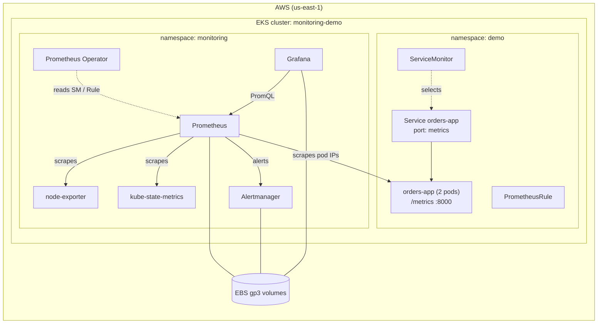

# Prometheus + Grafana Monitoring on Amazon EKS (with Custom Metrics)

A hands-on lab that builds a complete monitoring stack on **Amazon EKS** using **Terraform** and the **kube-prometheus-stack** Helm chart. It then instruments a sample Python app with **custom metrics**, scrapes it with a **ServiceMonitor**, fires a **custom alert**, and visualises everything in a **Grafana dashboard stored as code**.

> Built by typing every file by hand: Terraform, Helm values and Kubernetes manifests.

---

## Architecture



**Flow:** `app.py` exposes `/metrics` → the **ServiceMonitor** finds the Service by label → Prometheus discovers the **pod IPs** and scrapes each pod → the **PrometheusRule** evaluates alerts → **Alertmanager** receives them → **Grafana** queries Prometheus with PromQL.

---

## What you will learn

| Topic | Covered |
|---|---|
| EKS with Terraform (module v21) | VPC, managed node group, add-ons, `before_compute` |
| EBS CSI driver with **EKS Pod Identity** | IAM role without static keys |
| StorageClass | gp3 default, `WaitForFirstConsumer` |
| kube-prometheus-stack | Prometheus, Alertmanager, Grafana, node-exporter, kube-state-metrics |
| Persistence | Metrics, alerts and dashboards survive pod restarts |
| **Custom metrics** | Counter, Histogram and Gauge with `prometheus_client` |
| ServiceMonitor | How label selection and service discovery work |
| PrometheusRule | A custom alert: Pending → Firing → Alertmanager |
| Grafana dashboard as code | A ConfigMap picked up by the Grafana sidecar |
| Break and fix | Two real "target disappeared" scenarios |

---

## Repository structure

```
.
├── terraform/
│   ├── versions.tf        # Terraform + AWS provider versions
│   ├── variables.tf       # region, cluster name, K8s version, CIDR, instance type
│   ├── vpc.tf             # VPC, 3 AZs, private/public subnets, NAT, ELB tags
│   ├── eks.tf             # EKS cluster, add-ons, managed node group
│   ├── ebs-csi.tf         # Pod Identity IAM role for the EBS CSI driver
│   └── outputs.tf         # cluster name, role ARN, kubeconfig command
├── helm/
│   └── kube-prometheus-values.yaml   # selectors, retention, persistence, Grafana
└── k8s/
    ├── storageclass.yaml       # default gp3 StorageClass
    ├── sample-app.yaml         # Namespace + ConfigMap(app.py) + Deployment + Service
    ├── servicemonitor.yaml     # tells Prometheus to scrape orders-app
    ├── prometheusrule.yaml     # custom alerts
    └── grafana-dashboard.yaml  # "Orders App" dashboard as code
```

---

## Prerequisites

- An AWS account and the AWS CLI configured (`aws sts get-caller-identity`)
- Terraform **>= 1.9**
- kubectl (within one minor version of the cluster, e.g. 1.34–1.36 for 1.35)
- Helm 3

> 💰 **Cost:** EKS control plane (~$0.10/hour) + 2 × t3.large + NAT gateway + EBS. Roughly **$0.35/hour**. **Destroy when you finish.**

---

## Step 1: Provision EKS with Terraform

```bash
cd terraform
terraform init
terraform plan -out tfplan
terraform apply tfplan
```

Connect kubectl and verify:

```bash
aws eks update-kubeconfig --name monitoring-demo --region us-east-1
kubectl get nodes -L node.kubernetes.io/instance-type
kubectl get pods -n kube-system
```

✅ Expected: **2 Ready t3.large** nodes, plus `ebs-csi-controller`, `aws-node`, `coredns` and `eks-pod-identity-agent` all Running.

---

## Step 2: Default gp3 StorageClass

```bash
cd ..
kubectl apply -f k8s/storageclass.yaml
kubectl get storageclass
```

✅ Expected: `gp3 (default)   ebs.csi.aws.com   Delete   WaitForFirstConsumer   true`

| Field | Why |
|---|---|
| `provisioner: ebs.csi.aws.com` | The EBS CSI add-on creates the disks |
| `type: gp3` | Cheaper and faster than gp2 |
| `WaitForFirstConsumer` | The disk is created in the **same AZ** as the pod's node |
| `reclaimPolicy: Delete` | Deleting the PVC deletes the EBS volume (use `Retain` in prod) |

---

## Step 3: Install kube-prometheus-stack

```bash
helm repo add prometheus-community https://prometheus-community.github.io/helm-charts
helm repo update
helm install monitoring prometheus-community/kube-prometheus-stack \
  -n monitoring --create-namespace \
  -f helm/kube-prometheus-values.yaml

kubectl get pods -n monitoring
kubectl get pvc -n monitoring
```

✅ Expected: all pods Running, and **3 PVCs Bound** (Prometheus 20Gi, Alertmanager 5Gi, Grafana 5Gi).

**The key setting:**

```yaml
serviceMonitorSelectorNilUsesHelmValues: false
```

By default Prometheus only reads ServiceMonitors labelled `release: <helm-release-name>`. Setting it to `false` makes it read **all** ServiceMonitors in **all** namespaces (`serviceMonitorNamespaceSelector: {}`). The same applies to PodMonitors and PrometheusRules.

---

## Step 4: Explore Prometheus and Grafana

```bash
kubectl port-forward -n monitoring svc/monitoring-kube-prometheus-prometheus 9090:9090
kubectl port-forward -n monitoring svc/monitoring-grafana 3000:80
kubectl port-forward -n monitoring svc/monitoring-kube-prometheus-alertmanager 9093:9093
```

- Prometheus: http://localhost:9090 → **Status → Target health**
- Grafana: http://localhost:3000 (admin / admin123) → **Dashboards**
- Alertmanager: http://localhost:9093 (a **Watchdog** alert always fires by design)

Try these, one query at a time:

```promql
up
sum(rate(node_cpu_seconds_total{mode!="idle"}[5m])) by (instance)
kube_pod_container_status_restarts_total
```

**Where the built-in targets come from**

| Target | Source |
|---|---|
| node-exporter, kube-state-metrics | **Exporters installed by the Helm chart** |
| kubelet / cAdvisor, apiserver, CoreDNS | **Built in**; they already expose `/metrics` |
| Prometheus, Alertmanager, Grafana, Operator | Each exposes its own `/metrics` |

---

## Step 5: Sample app with custom metrics

```bash
kubectl apply -f k8s/sample-app.yaml
kubectl get pods -n demo
kubectl port-forward -n demo svc/orders-app 8000:8000
curl -s localhost:8000/metrics | grep -E "^orders|^order_processing"
```

The app's code lives in a **ConfigMap**, so there is no Docker image to build. It simulates traffic and exposes:

| Metric | Type | Meaning |
|---|---|---|
| `orders_total{status="success\|failed"}` | Counter | Total orders; only goes up |
| `order_processing_seconds` | Histogram | Processing time, for p95/p99 |
| `orders_in_queue` | Gauge | Current queue size; goes up and down |

`FAIL_RATE` (an environment variable, default `0.05`) controls the failure percentage.

---

## Step 6: ServiceMonitor

```bash
kubectl apply -f k8s/servicemonitor.yaml
```

✅ In Prometheus, **Target health** → search `orders` → `serviceMonitor/demo/orders-app/0`, **2/2 UP**.

**The three selection levels**

```
Prometheus ──(1)──▶ ServiceMonitor ──(2)──▶ Service ──(3)──▶ Pods
```

| # | Match | Controlled by |
|---|---|---|
| 1 | Which ServiceMonitors Prometheus reads | `serviceMonitorSelectorNilUsesHelmValues` (Helm values) |
| 2 | Which Service the ServiceMonitor selects | `selector.matchLabels` ↔ Service `metadata.labels` |
| 3 | Which pods the Service has | Service `spec.selector` ↔ Pod labels |

Prometheus does **not** scrape through the Service. It reads the Service's **EndpointSlice** and scrapes **each pod IP** directly, giving per-pod metrics.

```bash
kubectl get endpointslices -n demo -l kubernetes.io/service-name=orders-app
```

Useful queries:

```promql
sum(rate(orders_total[1m])) by (status)
histogram_quantile(0.95, sum(rate(order_processing_seconds_bucket[5m])) by (le))
orders_in_queue
```

> `up` means "could Prometheus scrape this target?" It does **not** mean "is the pod running?". For that, use `kube_pod_status_phase` from kube-state-metrics.

---

## Step 7: Custom alert (PrometheusRule)

```bash
kubectl apply -f k8s/prometheusrule.yaml
```

| Alert | Condition |
|---|---|
| `HighOrderFailureRate` | Failed orders above 10% for 2 minutes |
| `OrdersAppDown` | `up == 0` for 1 minute |
| `OrdersAppMissing` | `absent(up{job="orders-app"})` for 2 minutes: catches a target that silently disappears |

**Trigger it** by simulating a bad release:

```bash
kubectl set env deployment/orders-app -n demo FAIL_RATE=0.3
```

✅ **Prometheus → Alerts**: Inactive → **Pending** → **Firing** (after `for: 2m`). It then appears in **Alertmanager**.

Revert:

```bash
kubectl set env deployment/orders-app -n demo FAIL_RATE=0.05
```

---

## Step 8: Break and fix

### Break 1: label mismatch
Change the ServiceMonitor `matchLabels` to `app: orders-api` and apply it.

- ❌ The target disappears, `up{job="orders-app"}` returns **empty**, and there is **no error anywhere**.
- ❌ `OrdersAppDown` does **not** fire: a missing target produces *no* `up` series, not `up=0`. That's why the repo also ships `OrdersAppMissing`, which uses `absent()` and **does** fire after 2 minutes.
- ✅ Fix: make `matchLabels` match the Service's `metadata.labels`.

### Break 2: the Helm selector setting
```bash
helm upgrade monitoring prometheus-community/kube-prometheus-stack -n monitoring \
  -f helm/kube-prometheus-values.yaml \
  --set prometheus.prometheusSpec.serviceMonitorSelectorNilUsesHelmValues=true
```

- ❌ The `orders` target disappears, while the built-in targets stay UP. They carry `release=monitoring`:
  ```bash
  kubectl get servicemonitor -n monitoring --show-labels
  ```
- ✅ Fix A: add `labels: { release: monitoring }` to the ServiceMonitor.
- ✅ Fix B: set `serviceMonitorSelectorNilUsesHelmValues: false` again.

| Fix | When to use it |
|---|---|
| Label convention (`release: …`) | A platform team owns Prometheus; app teams follow the convention |
| Selector `false` / `{}` | One Prometheus scrapes everything in the cluster |

---

## Step 9: Grafana dashboard as code

```bash
kubectl apply -f k8s/grafana-dashboard.yaml
```

✅ Grafana → Dashboards → search **Orders App**: orders/sec, failure rate (green/red threshold at 10%), p95 latency, and queue size per pod.

**How it loads:** the Grafana pod runs a **sidecar** that watches ConfigMaps labelled `grafana_dashboard: "1"` in the `monitoring` namespace and loads their JSON automatically. Each panel's `expr` is an ordinary PromQL query.

---

## Clean-up (important)

```bash
helm uninstall monitoring -n monitoring
kubectl delete pvc --all -n monitoring       # Helm does NOT delete StatefulSet PVCs
kubectl delete -f k8s/sample-app.yaml
kubectl get pv                               # should be empty before you destroy

cd terraform
terraform destroy
```

> If `terraform destroy` fails with `DependencyViolation` on a subnet or security group, look for a leftover ENI or a load balancer in that VPC, delete it, and run destroy again.

---

## Production vs this lab

| Lab | Production |
|---|---|
| `helm install` by hand | Argo CD / GitOps, values in Git |
| Password in the values file | External Secrets / Secret Manager + SSO |
| port-forward | Ingress + TLS |
| 7-day retention, single replica | Thanos / Mimir for long-term storage, HA replicas |
| Alerts go nowhere | `AlertmanagerConfig` → PagerDuty / Slack |
| One cluster | Central Grafana across many clusters |

---

## Author

**Aniruddha Choudhary**: Cloud, DevOps and DevSecOps engineer moving into MLOps and LLMOps.

If this helped you, ⭐ the repo and connect with me on LinkedIn.