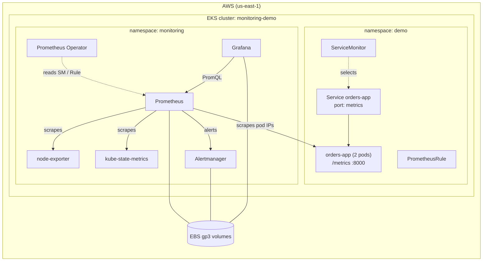

# Prometheus + Grafana Monitoring on Amazon EKS: Concepts and Hands-on Lab

Learn **how Kubernetes monitoring works**, then build it yourself on **Amazon EKS** with **Terraform** and **Helm**. You will instrument an app with **custom metrics**, scrape it, fire a **custom alert**, and see it on a **Grafana dashboard stored as code**.

📘 A step-by-step PDF guide is included: [`EKS-Monitoring-Guide.pdf`](EKS-Monitoring-Guide.pdf)

---

## Contents

1. [Monitoring in one minute](#1-monitoring-in-one-minute)
2. [Core concepts](#2-core-concepts)
3. [Tech stack: what each tool does](#3-tech-stack-what-each-tool-does)
4. [How it fits together](#4-how-it-fits-together)
5. [How this helps in real production](#5-how-this-helps-in-real-production)
6. [What we build in this lab](#6-what-we-build-in-this-lab)
7. [Hands-on lab: step by step](#7-hands-on-lab-step-by-step)
8. [Production vs this lab](#8-production-vs-this-lab)
9. [Clean-up](#9-clean-up)

---

## 1. Monitoring in one minute

Your apps run as **pods** on **nodes**. When something goes wrong (a slow API, a crashing pod, a full disk), you need to know **before your users do**.

- **Prometheus** visits every component every 15–30 seconds, reads its numbers (CPU, requests, errors…), and stores them over time.
- **Grafana** turns those numbers into dashboards.
- **Alertmanager** tells a human (Slack, PagerDuty, email) when a number crosses a limit.

> **Think of a car dashboard.** The sensors are **exporters**, the car's computer recording readings is **Prometheus**, the dashboard gauges are **Grafana**, and the warning light and beep are **Alertmanager**.

---

## 2. Core concepts

### 2.1 The three pillars of observability

| Pillar | What it is | Answers | Example tools |
|---|---|---|---|
| **Metrics** | Numbers over time | *Is something wrong?* | **Prometheus**, CloudWatch |
| **Logs** | Detailed event records | *What exactly happened?* | Loki, ELK, CloudWatch Logs |
| **Traces** | One request's path across services | *Where is it slow or failing?* | Jaeger, Tempo, AWS X-Ray |

This lab covers **metrics**, the first signal in almost every incident.

### 2.2 Pull model

Prometheus **pulls**: it sends `HTTP GET /metrics` to each target on a schedule (a **scrape**). Apps don't push anything.

```
Prometheus ──GET /metrics every 15s──▶ app / exporter
```

| | Pull (Prometheus) | Push (StatsD, CloudWatch agent) |
|---|---|---|
| Who starts it | Prometheus | The app |
| Detects a dead target | ✅ Yes: the scrape fails, so `up = 0` | ❌ Silence looks like "no traffic" |
| Short batch jobs | Use the **Pushgateway** | Native |

### 2.3 What a metric looks like

```
orders_total{status="failed", pod="orders-app-7d9f"}  42
└─ name ─┘  └──────────── labels ────────────┘     └ value
```

Each unique **name + label set** is a **time series**: a value stored every scrape.

### 2.4 Metric types

| Type | Behaviour | Example | Typical query |
|---|---|---|---|
| **Counter** | Only goes up (resets on restart) | `orders_total`, `http_requests_total` | `rate(orders_total[1m])` |
| **Gauge** | Goes up and down | `orders_in_queue`, memory used | Use the value directly |
| **Histogram** | Counts values in buckets | `order_processing_seconds` | `histogram_quantile(0.95, …)` |
| **Summary** | Quantiles calculated in the app | Rarely used on Kubernetes | Can't be aggregated across pods |

> **Label cardinality:** never use unbounded values such as `user_id` or `order_id` as labels. Every new value creates a new series and can crash Prometheus.

### 2.5 What to monitor

| Method | For | Signals |
|---|---|---|
| **Golden signals** (Google SRE) | Any service | **Latency, Traffic, Errors, Saturation** |
| **RED** | Request-driven services (APIs) | **Rate, Errors, Duration** |
| **USE** | Resources (nodes, disks) | **Utilisation, Saturation, Errors** |

### 2.6 Exporters vs built-in metrics

| Source | Meaning | Examples |
|---|---|---|
| **Exporter** | A translator for software that doesn't speak Prometheus | node-exporter (Linux), kube-state-metrics (Kubernetes objects), mysqld-exporter |
| **Built-in** | Software that already exposes `/metrics` | kubelet / cAdvisor, API server, CoreDNS, Prometheus itself |
| **Client library** | **Your own app** exposes custom metrics | `prometheus_client` (Python), Micrometer (Java), `prom-client` (Node.js) |

### 2.7 Alerts

```
PrometheusRule (expr + for) ──▶ Prometheus evaluates ──▶ Inactive → Pending → Firing ──▶ Alertmanager ──▶ Slack / PagerDuty
```

- **Prometheus** decides *whether* something is wrong (it evaluates rules).
- **Alertmanager** decides *who hears about it, and how*: routing, grouping, silencing, inhibition.

### 2.8 The Prometheus Operator

On Kubernetes you don't edit `prometheus.yml` by hand. The **Prometheus Operator** adds **CRDs**, and you describe monitoring as Kubernetes YAML:

| CRD | Purpose |
|---|---|
| `ServiceMonitor` | "Scrape the pods behind this **Service**" |
| `PodMonitor` | "Scrape these **pods** directly" (no Service) |
| `PrometheusRule` | Alert and recording rules |
| `AlertmanagerConfig` | Where alerts go |

The Operator watches these objects and regenerates Prometheus's configuration automatically.

---

## 3. Tech stack: what each tool does

| Layer | Tool | Role in this lab | Why it's used |
|---|---|---|---|
| Cloud | **Amazon EKS 1.35** | Managed Kubernetes; AWS runs the control plane | Industry-standard managed Kubernetes |
| IaC | **Terraform** + `terraform-aws-modules` (vpc, eks v21, eks-pod-identity) | Builds the VPC, cluster, node group, add-ons and IAM | Repeatable and reviewable infrastructure |
| Network | **VPC**: 3 AZs, private and public subnets, 1 NAT | Nodes in private subnets | Production-like layout |
| Compute | **Managed node group**, 2 × t3.large | Worker nodes for all pods | Simple and AWS-managed |
| Storage | **EBS CSI driver** + **gp3 StorageClass** | Creates EBS disks for PVCs | Prometheus, Alertmanager and Grafana need persistent data |
| Identity | **EKS Pod Identity** | IAM role for the EBS CSI driver | No static AWS keys in pods |
| Packaging | **Helm 3** | Installs the monitoring stack | One command, configured by a values file |
| Monitoring | **kube-prometheus-stack** | Prometheus + Operator + Alertmanager + Grafana + exporters + default dashboards and alerts | The most common Kubernetes monitoring bundle |
| Collection | **Prometheus** | Scrapes, stores (7 days) and evaluates rules | The de facto metrics standard (CNCF) |
| Exporters | **node-exporter**, **kube-state-metrics** | Node health; Kubernetes object state | Infrastructure visibility out of the box |
| Alerting | **Alertmanager** | Receives, groups and routes alerts | Separates detection from notification |
| Visualisation | **Grafana** (+ dashboard sidecar) | Dashboards; loads dashboards from ConfigMaps | Dashboards as code |
| App | **Python** + **`prometheus_client`** | Sample `orders-app` with custom metrics | Shows how developers instrument code |
| Config as code | **ServiceMonitor**, **PrometheusRule**, dashboard **ConfigMap** | Scrape, alert and dashboard definitions | Everything lives in Git |

---

## 4. How it fits together



### How Prometheus finds your app (three label matches)

```
Prometheus ──(1)──▶ ServiceMonitor ──(2)──▶ Service ──(3)──▶ Pods
```

| # | Match | Set by |
|---|---|---|
| 1 | Which ServiceMonitors Prometheus reads | Helm value `serviceMonitorSelectorNilUsesHelmValues` (default: only those labelled `release: <helm-release>`) |
| 2 | Which Service the ServiceMonitor picks | `spec.selector.matchLabels` ↔ the Service's `metadata.labels` |
| 3 | Which pods sit behind the Service | Service `spec.selector` ↔ pod labels |

Prometheus **doesn't scrape through the Service**. It reads the Service's **EndpointSlice** (the pod IPs) and scrapes **each pod directly**, which gives per-pod metrics.

### What `up` means
`up = 1` means Prometheus **scraped the target successfully**, and `up = 0` means it **failed**. It does **not** mean "the pod is running". For that, use `kube_pod_status_phase` from kube-state-metrics.

---

## 5. How this helps in real production

| Use case | How monitoring helps |
|---|---|
| **Detect incidents early** | Alerts on error rate and latency fire **before customers complain**, which reduces MTTD |
| **Faster troubleshooting** | Dashboards show *what changed, when, and where* (pod, node, release), which reduces MTTR |
| **Safe releases** | Watch the error rate after each deploy; roll back fast. It drives canary analysis (Argo Rollouts, Flagger) |
| **SLOs and error budgets** | Measure availability and latency SLIs, e.g. "99.9% of orders succeed" |
| **Capacity planning and FinOps** | Compare **requests vs actual usage** to right-size pods and nodes and cut cost |
| **Autoscaling** | Custom metrics such as queue length or requests/sec can drive **HPA** (prometheus-adapter) or **KEDA** |
| **Business visibility** | Custom metrics like **orders/min** and **failed payments** sit next to the technical metrics |
| **On-call** | Alertmanager routes `severity=critical` to **PagerDuty** and warnings to **Slack**, with silences during maintenance |
| **MLOps / LLMOps** | Model latency, prediction errors, **GPU usage** (DCGM exporter), token throughput |

---

## 6. What we build in this lab

| Component | Details |
|---|---|
| EKS cluster | `monitoring-demo`, Kubernetes 1.35, 2 × t3.large managed nodes |
| Storage | Default **gp3** StorageClass (EBS CSI + Pod Identity) |
| Monitoring stack | kube-prometheus-stack with persistence for Prometheus (20Gi), Alertmanager (5Gi) and Grafana (5Gi) |
| Sample app | `orders-app` (2 pods): Python code in a ConfigMap, so **no image build** |
| Custom metrics | `orders_total` (Counter), `order_processing_seconds` (Histogram), `orders_in_queue` (Gauge) |
| Scraping | `ServiceMonitor` |
| Alerts | `HighOrderFailureRate`, `OrdersAppDown`, `OrdersAppMissing` |
| Dashboard | "Orders App" Grafana dashboard as code |
| Break and fix | Two "target disappeared" scenarios |

### Repository structure

```
.
├── terraform/
│   ├── versions.tf        # Terraform + AWS provider versions
│   ├── variables.tf       # region, cluster name, K8s version, CIDR, instance type
│   ├── vpc.tf             # VPC, 3 AZs, private/public subnets, NAT, ELB tags
│   ├── eks.tf             # EKS cluster, add-ons, managed node group
│   ├── ebs-csi.tf         # Pod Identity IAM role for the EBS CSI driver
│   └── outputs.tf         # cluster name, role ARN, kubeconfig command
├── helm/
│   └── kube-prometheus-values.yaml   # selectors, retention, persistence, Grafana
├── k8s/
│   ├── storageclass.yaml       # default gp3 StorageClass
│   ├── sample-app.yaml         # Namespace + ConfigMap(app.py) + Deployment + Service
│   ├── servicemonitor.yaml     # tells Prometheus to scrape orders-app
│   ├── prometheusrule.yaml     # custom alerts
│   └── grafana-dashboard.yaml  # "Orders App" dashboard as code
└── EKS-Monitoring-Guide.pdf    # concepts + lab guide
```

### Prerequisites

- An AWS account and the AWS CLI configured (`aws sts get-caller-identity`)
- Terraform **>= 1.9**, Helm 3, and kubectl (within one minor version of 1.35)

> 💰 **Cost:** about **$0.35/hour** (EKS control plane + 2 × t3.large + NAT + EBS). **Run the clean-up when you finish.**

---

## 7. Hands-on lab: step by step

### Step 1: Provision EKS with Terraform

```bash
cd terraform
terraform init
terraform plan -out tfplan
terraform apply tfplan

aws eks update-kubeconfig --name monitoring-demo --region us-east-1
kubectl get nodes -L node.kubernetes.io/instance-type
kubectl get pods -n kube-system
```

✅ **2 Ready t3.large** nodes, plus `ebs-csi-controller`, `aws-node`, `coredns` and `eks-pod-identity-agent` all Running.

### Step 2: Default gp3 StorageClass

```bash
cd ..
kubectl apply -f k8s/storageclass.yaml
kubectl get storageclass
```

✅ `gp3 (default)   ebs.csi.aws.com   Delete   WaitForFirstConsumer   true`

| Field | Why |
|---|---|
| `provisioner: ebs.csi.aws.com` | The EBS CSI add-on creates the disks |
| `type: gp3` | Cheaper and faster than gp2 |
| `WaitForFirstConsumer` | The disk is created in the **same AZ** as the pod's node |
| `reclaimPolicy: Delete` | Deleting the **PVC** deletes the EBS volume (use `Retain` in prod) |

### Step 3: Install kube-prometheus-stack

```bash
helm repo add prometheus-community https://prometheus-community.github.io/helm-charts
helm repo update
helm install monitoring prometheus-community/kube-prometheus-stack \
  -n monitoring --create-namespace \
  -f helm/kube-prometheus-values.yaml

kubectl get pods -n monitoring
kubectl get pvc -n monitoring
```

✅ All pods Running, and **3 PVCs Bound** (20Gi, 5Gi, 5Gi).

| Value | Why |
|---|---|
| `serviceMonitorSelectorNilUsesHelmValues: false` (+ PodMonitor and rule versions) | Read **all** ServiceMonitors and rules, not just those labelled `release: monitoring` |
| `serviceMonitorNamespaceSelector: {}`, `ruleNamespaceSelector: {}` | From **every** namespace |
| `retention: 7d` | Keep metrics for 7 days |
| `storageSpec` / `storage` / `persistence` on gp3 | Data survives pod restarts |
| `kubeScheduler / kubeControllerManager / kubeEtcd: enabled: false` | EKS hides the control plane; this avoids false "Down" alerts |

### Step 4: Explore Prometheus, Grafana and Alertmanager

```bash
kubectl port-forward -n monitoring svc/monitoring-kube-prometheus-prometheus 9090:9090
kubectl port-forward -n monitoring svc/monitoring-grafana 3000:80
kubectl port-forward -n monitoring svc/monitoring-kube-prometheus-alertmanager 9093:9093
```

- Prometheus: http://localhost:9090 → **Status → Target health**
- Grafana: http://localhost:3000 (`admin` / `admin123`) → **Dashboards**: *Kubernetes / Compute Resources / Cluster*, *Node Exporter / Nodes*
- Alertmanager: http://localhost:9093 (the **Watchdog** alert always fires, by design)

Run one query at a time:

```promql
up
sum(rate(node_cpu_seconds_total{mode!="idle"}[5m])) by (instance)
kube_pod_container_status_restarts_total
```

### Step 5: Sample app with custom metrics

```bash
kubectl apply -f k8s/sample-app.yaml
kubectl get pods -n demo
kubectl port-forward -n demo svc/orders-app 8000:8000
curl -s localhost:8000/metrics | grep -E "^orders|^order_processing"
```

| Metric | Type | Meaning |
|---|---|---|
| `orders_total{status="success\|failed"}` | Counter | Total orders |
| `order_processing_seconds` | Histogram | Processing time, for p95/p99 |
| `orders_in_queue` | Gauge | Current queue size |

`FAIL_RATE` (an env var, default `0.05`) controls the failure percentage.

### Step 6: ServiceMonitor

```bash
kubectl apply -f k8s/servicemonitor.yaml
kubectl get endpointslices -n demo -l kubernetes.io/service-name=orders-app
```

✅ Prometheus → **Target health** → search `orders` → `serviceMonitor/demo/orders-app/0`, **2/2 UP**.

```promql
sum(rate(orders_total[1m])) by (status)
histogram_quantile(0.95, sum(rate(order_processing_seconds_bucket[5m])) by (le))
orders_in_queue
```

### Step 7: Custom alerts (PrometheusRule)

```bash
kubectl apply -f k8s/prometheusrule.yaml
```

| Alert | Condition |
|---|---|
| `HighOrderFailureRate` | Failed orders above 10% for 2 minutes |
| `OrdersAppDown` | `up == 0` for 1 minute |
| `OrdersAppMissing` | `absent(up{job="orders-app"})` for 2 minutes: the target silently disappeared |

Simulate a bad release:

```bash
kubectl set env deployment/orders-app -n demo FAIL_RATE=0.3
```

✅ **Prometheus → Alerts**: Inactive → **Pending** → **Firing**, then visible in **Alertmanager**.

```bash
kubectl set env deployment/orders-app -n demo FAIL_RATE=0.05   # revert
```

### Step 8: Break and fix

**Break 1: label mismatch.** Set the ServiceMonitor's `matchLabels` to `app: orders-api` and apply it.
- The target disappears and `up{job="orders-app"}` returns **empty**, with **no error anywhere**.
- `OrdersAppDown` doesn't fire (there's no series, not `up = 0`). **`OrdersAppMissing` does**.
- ✅ Fix: match the Service's labels again.

**Break 2: the Helm selector setting.**
```bash
helm upgrade monitoring prometheus-community/kube-prometheus-stack -n monitoring \
  -f helm/kube-prometheus-values.yaml \
  --set prometheus.prometheusSpec.serviceMonitorSelectorNilUsesHelmValues=true
```
- The `orders` target disappears; the built-in targets stay UP because they have `release=monitoring` (`kubectl get servicemonitor -n monitoring --show-labels`).
- ✅ Fix A: label the ServiceMonitor `release: monitoring` (already in this repo).
- ✅ Fix B: run `helm upgrade` again without the `--set`.

### Step 9: Grafana dashboard as code

```bash
kubectl apply -f k8s/grafana-dashboard.yaml
```

✅ Grafana → Dashboards → **Orders App**: orders/sec, failure rate (red above 10%), p95 latency, queue per pod.

The Grafana pod runs a **sidecar** that loads any ConfigMap labelled `grafana_dashboard: "1"` in the `monitoring` namespace. Each panel's `expr` is a normal **PromQL** query.

---

## 8. Production vs this lab

| This lab | Real production |
|---|---|
| `helm install` by hand | **Argo CD / GitOps**, values in Git |
| Password in the values file | **External Secrets / Secret Manager** + SSO |
| port-forward | **Ingress + TLS** with a domain |
| 7-day retention, single replica | **Thanos / Mimir** for long-term storage; HA replicas |
| Alerts go nowhere | **AlertmanagerConfig** → PagerDuty / Slack |
| One cluster | Central Grafana across many clusters, or Amazon Managed Prometheus / Grafana |

---

## 9. Clean-up

```bash
helm uninstall monitoring -n monitoring
kubectl delete pvc --all -n monitoring      # Helm does not delete StatefulSet PVCs
kubectl delete -f k8s/sample-app.yaml
kubectl get pv                              # must be empty

cd terraform
terraform destroy
```

---

## Author

**Aniruddha Choudhary**: Cloud, DevOps and DevSecOps engineer moving into MLOps and LLMOps.

If this helped you, ⭐ the repo and connect with me on LinkedIn.